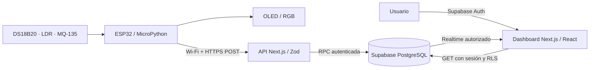

# Aqua Monitor — Monitoreo ambiental IoT

## Entrega actual — 25 de noviembre de 2026

Alcance actual: **temperatura DS18B20, luz LDR y respuesta de gas MQ-135**, con OLED y RGB. No hay sensor de humedad instalado. `soil_adc` permanece como compatibilidad del contrato, sin eliminar históricos. La documentación histórica al final describe etapas anteriores, no el estado de esta entrega.

### Enlaces para los compañeros

- [Web publicada](https://aqua-monitor-gamma.vercel.app).
- [Dashboard](https://aqua-monitor-gamma.vercel.app/dashboard) y [Historial](https://aqua-monitor-gamma.vercel.app/dashboard/history): requieren sesión y acceso autorizado a la estación.
- [Swagger](https://aqua-monitor-gamma.vercel.app/swagger), [OpenAPI](https://aqua-monitor-gamma.vercel.app/api/openapi) y [Privacidad](https://aqua-monitor-gamma.vercel.app/privacy).
- [Código en GitHub](https://github.com/KevinTapiaAli/aqua-monitor).
- [Guía del documento del tercer parcial](docs/TERCER_PARCIAL.md).

### Qué está confirmado y qué falta

Actualización de seguridad: Next.js y eslint-config-next **16.4.6**. Auditoría npm posterior a correcciones compatibles: **0 vulnerabilidades reportadas** al preparar esta entrega; no equivale a garantía de seguridad futura. TypeScript y lint finalizaron sin errores. [Detalle de verificación](docs/STATUS.md).

El usuario confirmó lecturas físicas en Thonny y despliegues en Vercel. Su última captura web todavía mostraba una recepción antigua. **Falta confirmar HTTP 201 reciente y la misma medición en historial.** El último error HTTPS informado fue `-15104`; no se considera resuelto solo por publicar la web.

El usuario confirmó aplicada la migración ambiental `202610190001`. No recrear la base ni volver a ejecutar migraciones aplicadas. El `aqua_real.py` de este repositorio es una integración preparada: la última captura de la placa muestra otra versión. Respaldar y comparar el programa físico que funciona antes de reemplazarlo.

### Arquitectura y tecnologías



Frontend React/TypeScript, gráficas canvas, backend Route Handlers Next.js, Supabase Auth/PostgreSQL y Vercel. Firmware MicroPython con GPIO, ADC, OneWire e I2C. No utiliza MQTT ni servidor Python para la web.

### Hardware y significado de los datos

| Elemento | Conexión informada | Interpretación |
| --- | --- | --- |
| DS18B20 | DATA GPIO4; 3V3; pull-up 4,7 kΩ DATA–3V3 | Temperatura original °C |
| LDR tres pines | S/OUT GPIO34; 3V3 y GND | ADC; estado calculado 0 oscuro / 1 con luz |
| MQ-135 | AO adaptada a GPIO35; calentador 5V; GND común | ADC y porcentaje de escala eléctrica |
| OLED SSD1306 128×64 | SDA21, SCL22; 3V3 y GND | Lecturas y estado técnico |
| RGB cátodo común según guía | R25, G26, B27 | Estado técnico en integración nueva, no calidad del aire |

`read_u16()` entrega 0–65535. La web permite 0–4095 para firmware que utilice esa escala; no mezclarlas. Luz usa umbral inicial 50%: ADC menor = más luz para el circuito descrito. El ajuste es local a la vista, no modifica registros. Gas se divide en tres franjas de señal, **no en concentraciones de gases**. El MQ-135 no distingue cuánto CO₂, amoníaco u otro gas hay en una mezcla; no se presentan ppm ni lux sin referencia apropiada.

La atenuación ADC no protege frente a 5V. Un divisor 10k/20k entrega nominalmente 3,33V con 5V: no garantiza un máximo de 3,3V. Comprobar la adaptación real antes de habilitar gas.

Las gráficas usan datos reales. El tramo punteado mantiene el último valor conocido, no crea muestras. Ausencia no se reemplaza por cero. Se conservan `raw`, calidad y fechas de adquisición/recepción.

### Desarrollo local en Visual Studio Code

Node.js >=22 y npm. PowerShell puede usar `.cmd` para evitar el bloqueo de `npm.ps1` sin cambiar políticas:

```powershell
git clone https://github.com/KevinTapiaAli/aqua-monitor.git
cd aqua-monitor
npm.cmd ci
npm.cmd run dev
```

Antes de iniciar, completar `.env.local` desde `.env.example` **solo si no existe**. No sobrescribir el entorno actual. Variables: `NEXT_PUBLIC_SUPABASE_URL`, `NEXT_PUBLIC_SUPABASE_PUBLISHABLE_KEY`, `SUPABASE_SERVICE_ROLE_KEY` (solo servidor), `APP_URL` (http://localhost:3000 local; dominio estable en producción). Abrir http://localhost:3000. Comprobaciones explícitas: `npm.cmd run typecheck`, `npm.cmd run lint`, `npm.cmd run build`.

### Base de datos, acceso y publicación

Supabase aloja PostgreSQL; no hace falta otra base local. Para un proyecto nuevo aplicar [migraciones](supabase/migrations) en orden; en el existente comprobar primero cuáles están aplicadas. Configurar Auth/redirecciones y Realtime según [SETUP](docs/SETUP.md). Entidades: `profiles`, `devices`, `device_users`, `measurements`, `calibrations`, `alert_rules`, `alerts` y credenciales en esquema privado. Las migraciones son la fuente exacta de tipos, PK/FK, índices, restricciones y políticas.

Registrarse no concede acceso a todas las estaciones: cada integrante usa su propia cuenta y obtiene acceso autorizado. No compartir contraseña ni service_role.

Proyecto Vercel existente: `kevin-tapia-ali/aqua-monitor`. Configurar las cuatro variables para producción; `APP_URL=https://aqua-monitor-gamma.vercel.app`.

```powershell
npx.cmd vercel login
npx.cmd vercel link
npx.cmd vercel --prod
```

Si Git despliega `main` automáticamente, comprobarlo antes de generar otro despliegue. READY no confirma envío del ESP32 ni RLS. Usar el alias estable para compartir y para `API_HOST`.

### MicroPython

1. Respaldar el programa que funciona y `config.py`, `boot.py`, `main.py`; secretos fuera de Git.
2. Comparar [aqua_real.py](firmware/aqua_real.py). Usa módulos existentes de Wi-Fi, reloj, telemetría, payload y HTTPS. No modifica arranque.
3. Mantener red, token y CA válidos. Host `aqua-monitor-gamma.vercel.app`, ruta `/api/v1/ingest`, puerto 443.
4. Instalar `ssd1306.py` compatible si falta. `OLED_ENABLED=True`; RGB acorde al circuito. Gas exige confirmaciones eléctricas y estabilización; no activarlas sin verificar.
5. Guardar en la placa y ejecutar F5, o `import aqua_real` y `aqua_real.ejecutar()` desde sesión limpia.
6. Confirmar Wi-Fi, NTP UTC, tres lecturas y HTTP 201; luego dashboard e historial.

Adquisición local aproximada de un segundo; envío predeterminado cada diez. NTP/HTTPS pueden bloquear el ciclo. Cola acotada en RAM, perdida al reiniciar. Diagnósticos manuales: [sensores](firmware/diagnostico_sensores.py) y [HTTPS sin POST ni token enviado](firmware/diagnostico_https.py). `-15104` indica clave pública inválida en Mbed TLS: no desactivar validación de certificados.

### Seguridad por capas

| Capa | Controles implementados |
| --- | --- |
| Usuario | Supabase Auth y sesión verificada en servidor |
| Frontend | Sin service_role; nosniff, anti-iframe y CSP parcial |
| API | Zod, JSON 16 KiB, plazo de lectura, control de origen, rechazo cross-site, errores sin secretos |
| Dispositivo | Token aleatorio propio, rotación/revocación, hash SHA-256 privado |
| Transporte | HTTPS con CA/hostname, hora UTC vía NTP |
| PostgreSQL | RLS, permisos, propiedad, restricciones e idempotencia dispositivo/reading_id |
| Exportación y Git | Protección de fórmulas CSV y exclusión de configuración privada |

Son controles de código, no certificación de seguridad. CSP es parcial. service_role evita RLS: solo servidor; la RPC valida el dispositivo antes de insertar. Ver [SECURITY](docs/SECURITY.md) y [comprobaciones](docs/MANUAL_CHECKS.md).

**Confirmar con el docente:** la rúbrica dice dashboard en Python; esta web es Next.js/React. MicroPython en el nodo no convierte el dashboard en Python.

---

## Documentación histórica — etapa del 19 de octubre

Sistema IoT de monitoreo ambiental: temperatura, humedad del suelo, gas MQ-135 y luz LDR.

Aplicación Next.js con Supabase Auth, PostgreSQL/RLS, API REST para ESP32 y dashboard en español. Temperatura DS18B20 integrada; entradas analógicas opcionales preparadas sin asignar conexiones desconocidas.

## Estado de esta entrega

El usuario confirmó lecturas reales de temperatura, HTTP 201 y visualización en Vercel. El cambio ambiental del 19/10 está preparado localmente: interfaz, API, firmware y nueva migración. Falta aplicar esa migración, publicar y actualizar la placa. No se ejecutaron pruebas ni builds para este cambio.

Sigue primero la sección **Actualización a sensores ambientales** de [docs/SETUP.md](docs/SETUP.md).

## Acceso local

Con el servidor activo en el puerto 3000:

- Web: [http://localhost:3000](http://localhost:3000) (muestra instalación si falta Supabase).
- Inicio de sesión: [http://localhost:3000/login](http://localhost:3000/login).
- Swagger: [http://localhost:3000/swagger](http://localhost:3000/swagger).
- OpenAPI JSON: [http://localhost:3000/api/openapi](http://localhost:3000/api/openapi).

Para volver a iniciarlo después de cerrar el proceso, ejecuta `npm run dev -- --hostname 127.0.0.1 --port 3000`. Son direcciones locales de este equipo, no un despliegue público.

Los sensores nuevos permanecen ausentes hasta configurar sus GPIO y atenuación después de revisar el circuito. La temperatura continúa con GPIO 4.

## Puesta en marcha

Sigue [docs/SETUP.md](docs/SETUP.md). En resumen:

1. Prepara Node.js 24 LTS y un proyecto Supabase.
2. Copia `.env.example` a `.env.local` y completa las variables.
3. Aplica las migraciones SQL en orden y configura Supabase Auth.
4. Cuando decidas ejecutar el proyecto, instala con `npm install` e inicia con `npm run dev`.
5. Registra una cuenta, crea un dispositivo y guarda su token privado.
6. Integra las lecturas existentes siguiendo [firmware/README.md](firmware/README.md).

## Organización

```text
src/
  app/                  Rutas, autenticación, pantallas y API v1
  components/           Interfaz organizada por funcionalidad
  hooks/                Suscripciones y sincronización Realtime
  lib/
    api/                Respuestas, errores, cliente y consultas
    auth/               Sesiones y credenciales de dispositivo
    supabase/           Clientes separados: navegador, sesión, ingesta
    utils/              Fechas, estado de conexión y CSV
  config/               Parámetros y etiquetas comunes
  types/                Contratos de dominio y PostgreSQL
supabase/migrations/    Esquema versionado, funciones y permisos
firmware/               Integración MicroPython, sin drivers inventados
docs/                   Instalación, arquitectura, API y comprobación manual
```

## Documentación

| Documento | Contenido |
| --- | --- |
| [Instalación](docs/SETUP.md) | Variables, Supabase, correo, arranque y Vercel |
| [Arquitectura](docs/ARCHITECTURE.md) | Flujo de datos, decisiones y crecimiento |
| [API](docs/API.md) | Endpoints, JSON, calidad y errores |
| [Seguridad](docs/SECURITY.md) | RLS, permisos, credenciales y límites |
| [Hardware](docs/HARDWARE.md) | Información pendiente y distribución del trabajo |
| [Verificación manual](docs/MANUAL_CHECKS.md) | Casos que deben ejecutarse antes de una demostración |
| [Estado](docs/STATUS.md) | Implementado, pendiente y limitaciones |

La aplicación monitorea variables fisicoquímicas. **No certifica potabilidad ni sustituye análisis microbiológicos o de laboratorio.**
