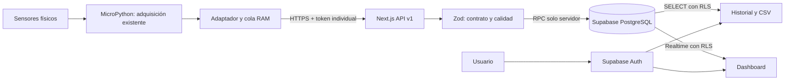

# Arquitectura

## Capas y responsabilidades

- **Firmware:** las funciones existentes realizan adquisición y conversión. La capa agregada organiza JSON, Wi-Fi, TLS y reintentos. No incluye algoritmos de calibración genéricos.
- **API:** valida contratos, sesión/origen o token, limita cuerpos, traduce errores y orquesta consultas. No duplica autenticación humana en la placa.
- **PostgreSQL:** determina autorización, aplica integridad, resuelve duplicados y confirma cada lectura con sus alertas en una transacción.
- **UI:** representa valores, calidad, unidades, hora de recepción y hora de adquisición. Consume APIs de consulta y Realtime sin hacer escrituras privilegiadas.

## Modelo de datos

`profiles` complementa Auth. `devices` identifica la estación. `device_users` relaciona usuarios autorizados; un propietario y lectores. `private.device_credentials` almacena exclusivamente SHA-256 del token vigente; `NULL` lo revoca. Ese esquema no es público.

`measurements` es un registro inmutable. `(device_id, reading_id)` es único. Los `float8` rechazan NaN/infinito con restricciones, y las marcas de tiempo son `timestamptz`. `measured_at` puede ser NULL cuando falta un reloj confiable; `received_at` lo genera PostgreSQL.

`quality` tiene un estado por parámetro; `raw` conserva lecturas originales con unidad. Temperatura usa °C; humedad del suelo, MQ-135 y LDR usan ADC (0–65535). Los valores sin calibrar se analizan como originales, sin convertirlos en porcentaje, CO2 ppm o lux. La migración ambiental archiva los datos de sensores retirados en el esquema privado y conserva la serie de temperatura.

`calibrations` registra evidencia y coeficientes, sin alterar automáticamente el firmware o la historia. `alert_rules` admite un mínimo y/o máximo por variable y dispositivo. `alerts` conserva eventos por lectura. Reconocer un evento no lo borra ni significa que el agua sea apta.

## Transacciones e idempotencia

`ingest_measurement` bloquea la fila del dispositivo y verifica su estado y token dentro de la misma transacción. El bloqueo serializa únicamente transmisiones de **ese dispositivo**. Las otras estaciones siguen independientes.

- Mismo ID y contenido normalizado: respuesta 200, sin repetir medición o alertas.
- Mismo ID con contenido distinto: 409, sin sobrescribir.
- Nueva lectura: 201; actualiza estado y genera los eventos aplicables.
- Intervalo entre nuevas inserciones menor de un segundo: 429; un duplicado ya confirmado no se vuelve a insertar.

Rotación y revocación toman el mismo bloqueo. El token se genera en el servidor con 32 bytes aleatorios; no se guarda en claro ni se vuelve a mostrar.

## Consultas y tiempo real

El índice `(device_id, received_at DESC, id DESC)` soporta historial y keyset pagination. Los filtros usan `[from, to)` por recepción, de hasta 31 días. Los relojes incorrectos de la placa no desplazan el historial. Gráficos y tabla conservan cronología de recepción, indicando aparte la fecha de adquisición.

El dashboard consulta 120 lecturas y conserva una ventana acotada. Una suscripción por dispositivo escucha mediciones, alertas y estado. Al reconectar obtiene una nueva ventana; no intenta descargar toda la historia. Limpia canales y peticiones al desmontar. El temporizador de estado corre localmente cada 10 segundos: no hace polling HTTP.

Las estadísticas de historial describen los registros **cargados**, con estado `ok`, sin mezclar unidades ni promediar errores. El CSV incluye todas las calidades, valores originales y timestamps del periodo, con un máximo de 10 000 filas. Si se supera, informa el límite sin descargar un archivo parcial como si estuviera completo.

## Crecimiento previsto

Mantener inicialmente esta aplicación y PostgreSQL. A 10 segundos hay 8 640 lecturas/día/dispositivo: planificar retención, copias de seguridad e índices antes de aumentar el número de estaciones.

Cuando el volumen lo justifique, añadir una migración de particionado/retención, agregados SQL por intervalo para periodos extensos y exportaciones paginadas mayores. La UI inicial muestra hasta 100 dispositivos, 100 calibraciones recientes y 50 alertas pendientes; ampliar esas consultas con cursores cuando sea necesario. No se han añadido colas externas, microservicios, MQTT ni Redis.

Los tipos de `src/types/database.ts` corresponden al esquema SQL escrito. Regenerarlos con la CLI de Supabase tras aplicar cambios de esquema y revisar los tipos de JSON de dominio antes de reemplazarlos. No fueron generados contra una base real en esta entrega.
