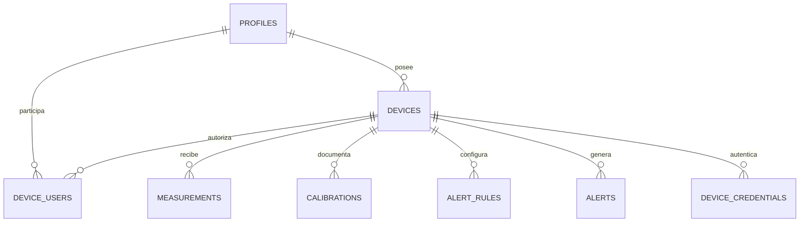

# Guía del equipo para el tercer parcial

25/11/2026. Material de apoyo, no informe final ni certificación de pruebas.

| Área | Entregable | Fuente |
| --- | --- | --- |
| Circuito/MicroPython | Pinout, diagrama, fotos, lectura real y manejo de errores | README, firmware/ |
| Red/API | ESP32–Wi-Fi–HTTPS–API–PostgreSQL–web, ejemplos POST/GET sin secretos | docs/API.md, Swagger |
| Base/seguridad | ER, diccionario, restricciones, índices, RLS y permisos | supabase/migrations/, docs/SECURITY.md |
| Frontend | Temperatura, luz 0/1, señal gas, gráficas, historial/CSV, privacidad | src/, web publicada |
| Integración | Capturas fechadas, resultados, problemas/soluciones, límites | docs/MANUAL_CHECKS.md y evidencia del equipo |

## Modelo conceptual

Resumen conceptual: usar las migraciones para nombres, FK, cardinalidades y tipos exactos del modelo físico. Credenciales pertenecen al esquema privado. Campos heredados no implican sensores instalados.

## Evidencias para cerrar la entrega

1. Consola reciente con tres variables, NTP UTC y HTTP 201.
2. Dashboard con recepción actual y cambio visible al iluminar/tapar LDR.
3. Historial y CSV del mismo intervalo, con adquisición y recepción diferenciadas.
4. OLED y RGB funcionando; explicar estado técnico, no alarma certificada.
5. Captura de mediciones y RLS en Supabase sin claves ni datos personales innecesarios.
6. Dos usuarios: el segundo no consulta una estación no autorizada. Documentar resultado real.
7. API: anónimo rechazado y dispositivo autorizado aceptado. Ocultar token en ejemplos.
8. Privacidad accesible, responsable/contacto definido y aceptación docente de Next.js ante el requisito dashboard Python.

El usuario mostró lecturas y despliegues. Falta evidencia reciente de ingesta completa y aislamiento entre usuarios. No presentar comprobaciones pendientes como realizadas.

## Defensa técnica

Flujo de información: adquirir → validar → almacenar → consultar → visualizar → interpretar. Luz es un umbral del ADC, no lux. MQ-135 es señal relativa, no CO₂ ppm ni gases separados. Las operaciones de red pueden retrasar la lectura. `raw` y calidad conservan trazabilidad; ausencia no se convierte en cero. RLS protege sesiones normales; service_role exige protección adicional de la RPC y debe permanecer solo en servidor.

## Qué compartir

- Código y README: https://github.com/KevinTapiaAli/aqua-monitor
- Web: https://aqua-monitor-gamma.vercel.app
- API: https://aqua-monitor-gamma.vercel.app/swagger
- Privacidad: https://aqua-monitor-gamma.vercel.app/privacy
- Fotos del circuito y capturas de la demostración sin secretos.

Nunca compartir `.env.local`, `config.py` privado, token aq_, service_role ni sesiones Vercel. Cada compañero utiliza su propia cuenta autorizada.

## Fuentes para el documento

- MicroPython: https://docs.micropython.org/en/latest/esp32/quickref.html
- DS18B20: https://www.analog.com/en/products/ds18b20.html
- MQ-135: https://www.winsen-sensor.com/sensors/voc-sensor/mq135.html
- Supabase RLS: https://supabase.com/docs/guides/database/postgres/row-level-security
- Supabase Auth: https://supabase.com/docs/guides/auth
- PostgreSQL: https://www.postgresql.org/docs/
- Next.js: https://nextjs.org/docs
- Vercel: https://vercel.com/docs

Para APA verificar autor institucional, título, fecha y versión consultada. No inventar fechas, calibraciones ni resultados.
